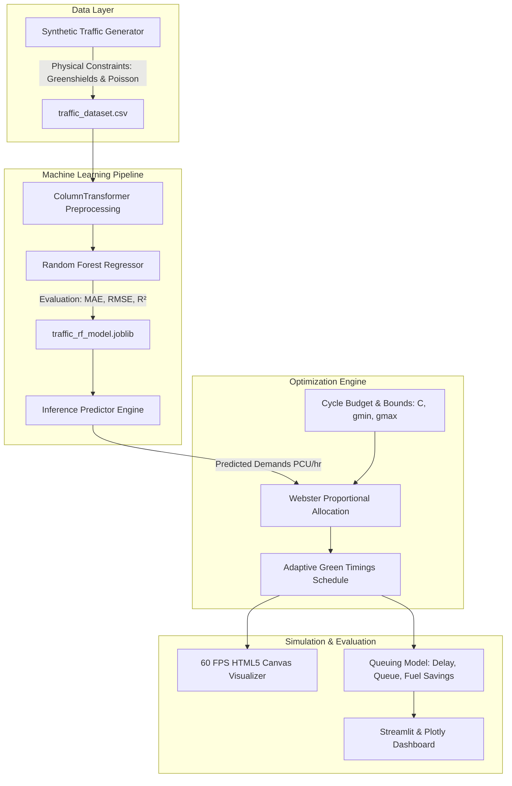

# TrafficIQ: AI-Based Traffic Signal Timing Optimization Using Machine Learning

**Academic Level:** Third-Year Computer Engineering Mini-Project  
**Domain:** Intelligent Transportation Systems (ITS) & Applied Machine Learning  
**Theme:** Professional Smart-City Light Management Dashboard  
**Technologies:** Python, Scikit-learn, Streamlit, Plotly, Pandas, NumPy, Joblib  

---

## 1. Project Overview & Motivation

Traditional urban traffic signal controllers operate on rigid, **fixed-time schedules** that do not adapt to fluctuating traffic density. During peak hours or asymmetric congestion events (such as sporting events, construction detours, or arterial rush hours), static signals allocate excessive green time to empty roads while heavily congested lanes experience spillback, extended queue delays, unnecessary fuel waste, and increased carbon emissions.

**TrafficIQ** solves this problem by decoupling the intelligence into two robust engineering layers:
1. **Machine Learning Predictive Layer:** A trained **Random Forest Regressor** forecasts short-term incoming traffic demand (in Passenger Car Units per hour, PCU/hr) for each approach based on vehicle counts, spatial density, queue lengths, vehicle speeds, and temporal features (hour of day, day of week).
2. **Constrained Signal Optimization Layer:** A **Webster-based Proportional Timing Algorithm** dynamically allocates the available green-light budget according to predicted demand while strictly honoring physical intersection safety bounds (minimum green, maximum green, yellow clearance, and all-red clearance intervals).

---

## 2. System Architecture



---

## 3. Mathematical & Algorithmic Formulation

### A. Signal Cycle Budget
For an isolated 4-way intersection ($N = 4$ phases: North, East, South, West):
$$\text{Total Lost Time } L = \sum_{i=1}^{4} (y_i + r_{\text{all}, i}) = 4 \times (3\text{s} + 1\text{s}) = 16\text{ seconds}$$
$$\text{Effective Green Budget } G_{\text{budget}} = C - L$$
where $C$ is the total cycle length (e.g., $120\text{s}$).

### B. Proportional Webster Green Allocation
Given predicted demand $D_i$ for approach $i \in \{\text{North, South, East, West}\}$:
$$w_i = \frac{D_i}{\sum_{j} D_j}$$
$$g_i = \text{clamp}\left( G_{\text{budget}} \times w_i, \, g_{\min}, \, g_{\max} \right)$$
An iterative bounded projection ensures strict cycle closure ($\sum g_i = G_{\text{budget}}$) with no negative or zero-duration allocations.

### C. Queuing Delay Formulation (Webster's Model)
$$d_i = \frac{C (1 - \lambda_i)^2}{2(1 - \min(0.95, \lambda_i x_i))} + \frac{x_i^2}{2 q_i (1 - \min(0.95, x_i))}$$
where $\lambda_i = g_i / C$ is the green ratio, $q_i$ is the arrival rate (veh/s), and $x_i$ is the degree of saturation.

---

## 4. Machine Learning Implementation

* **Model:** Random Forest Regressor (`sklearn.ensemble.RandomForestRegressor`)
* **Hyperparameters:** `n_estimators=120`, `max_depth=14`, `min_samples_split=4`, `random_state=42`
* **Features:**
  1. `road` (Categorical: North, South, East, West)
  2. `vehicle_count` (Approaching vehicles)
  3. `traffic_density` (veh/km)
  4. `queue_length` (meters)
  5. `avg_speed` (km/h)
  6. `hour_of_day` (0 - 23)
  7. `day_of_week` (0 - 6)
  8. `is_weekend` (0 or 1)
  9. `prev_waiting_time` (seconds)
* **Target:** `traffic_demand` (PCU/hr)
* **Model Evaluation Metrics on Held-Out Test Set:**
  * **Mean Absolute Error (MAE):** $21.72\text{ PCU/hr}$
  * **Root Mean Squared Error (RMSE):** $27.06\text{ PCU/hr}$
  * **$R^2$ Score:** $0.9945$ ($99.45\%$)

---

## 5. Dashboard Organization (5 Clean Tabs)

* **Tab 1: Live Traffic Simulation:** 60 FPS HTML5 Canvas intersection visualizer with moving vehicles, stop line braking, signal heads, countdown timers, and live operational cards.
* **Tab 2: Signal Optimization:** Dynamic signal timing table highlighting peak demand road, cycle budget summary, green allocation chart, and demand chart.
* **Tab 3: Performance Comparison:** Fixed-time vs adaptive strategy metrics, detailed approach-by-approach comparison table, and delay/throughput benchmark charts.
* **Tab 4: Analytics:** Spatial demand by road, green allocation breakdown, unserved queue length comparison, 24-hour diurnal demand curve, and multi-scenario analysis.
* **Tab 5: ML Model:** Data generation assumptions, model architecture, feature importance rankings, mathematical separation of concerns, and research simulation disclaimers.

---

## 6. Directory Structure

```
TrafficIQ/
│
├── data/
│   ├── generate_dataset.py       # Realistic synthetic traffic generator with documented assumptions
│   └── traffic_dataset.csv       # 6,000 synthetic observation records
│
├── models/
│   ├── train_model.py            # Random Forest training and evaluation script
│   ├── traffic_rf_model.joblib   # Serialized Scikit-learn pipeline
│   └── model_metadata.json       # Exported evaluation metrics and feature importances
│
├── src/
│   ├── __init__.py
│   ├── ml_predictor.py           # ML inference engine loading pipeline & metadata
│   ├── optimizer.py              # Constrained Webster signal timing optimizer with validation
│   ├── simulation_engine.py      # Queuing delay calculations and strategy benchmarker
│   ├── scenario_manager.py       # Predefined traffic scenario configurations (7 presets)
│   └── charts.py                 # Light-theme Plotly visualizations (7 charts)
│
├── components/
│   └── traffic_intersection.py   # Light-theme 60 FPS HTML5 Canvas 4-way visual simulation
│
├── static/
│   └── style.css                 # Smart-city light theme design system
│
├── app.py                        # Streamlit multi-tab dashboard application
├── requirements.txt              # Project dependencies
└── README.md                     # Engineering documentation
```

---

## 7. How to Run the Application

### 1. Install Dependencies
```bash
pip install -r requirements.txt
```

### 2. Generate Dataset & Train Model (Pre-trained files included)
```bash
python data/generate_dataset.py
python models/train_model.py
```

### 3. Launch Streamlit Application
```bash
streamlit run app.py
```
Open your browser at `http://localhost:8501`.

---

## 8. Predefined Scenarios Included

1. **Normal Traffic:** Balanced midday flow across all four approaches.
2. **Morning Rush Hour:** Inbound commuter surge choking North & South approaches.
3. **Evening Rush Hour:** Outbound commuter surge along East & West corridors.
4. **Low Traffic:** Sparse late-night arrivals allowing short, energy-efficient cycles.
5. **Heavy North Traffic:** Unilateral bottleneck / incident along North approach (88 vehicles).
6. **Heavy East Traffic:** Localized surge along East corridor (86 vehicles).
7. **Emergency Congestion:** Sudden detour surge along West approach (82 vehicles).

---

## 9. Educational Disclaimer
*This project was developed for educational simulation and academic demonstration purposes. All traffic patterns are simulated according to established traffic flow theory (Greenshields speed-density relations and Poisson arrival distributions) and analytical queuing delay models. They do not represent physical municipal telemetry.*
